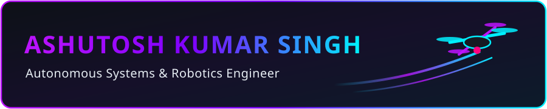
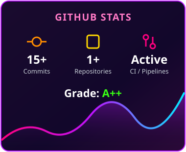
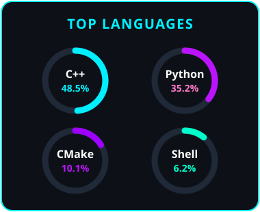

<!-- SELF-HOSTED NEON DRONE HEADER BANNER (ZERO DOWNTIME) -->

 

<!-- ANIMATED TYPING SUBTITLE -->

 

<!-- SOCIAL & CONTACT LINKS -->

 

---

### ⚡ CORE AUTONOMY & ENGINEERING STACK

<!-- ROW 1: CORE LANGUAGES & ROBOTICS -->

<!-- ROW 2: INFRASTRUCTURE & TOOLS -->

---

### 📊 TELEMETRY & GITHUB METRICS

<!-- 3-COLUMN NEON BENTO GRID -->
<table border="0" cellspacing="0" cellpadding="0">
  <tr>
    <td valign="middle" width="33%">
      
    </td>
    <td valign="middle" width="34%">
      
    </td>
    <td valign="middle" width="33%">
      
    </td>
  </tr>
</table>

---

### 🚀 FLAGSHIP ENGINEERING PROJECTS

| System / Repository | Core Architecture | Technical Highlights |
| :--- | :--- | :--- |
| **[RUDRA ANAV](https://github.com/Ashu25072003)** | `ROS 2` `ORB-SLAM` `C++` `RViz` | Real-time visual odometry and 3D point-cloud obstacle mapping for GPS-denied multi-drone navigation. |
| **[Swarm-Coordination](https://github.com/Ashu25072003)** | `Python` `ROS 2` `Lighthouse` | Multi-agent master-slave formation control with spatial positioning and gesture command execution. |
| **[Sensor-Fusion Pothole Detector](https://github.com/Ashu25072003)** | `OpenCV` `IMU Fusion` `Python` | Patent-filed hazard detection combining computer vision edge extraction with accelerometer and gyroscope telemetry. |
| **[Martian UAV Flight Sim](https://github.com/Ashu25072003)** | `ROS 2` `Gazebo` `MATLAB` | Autonomous flight control validation in simulated Martian atmospheric conditions (IRoC-U 2025 Grand Finalist). |
